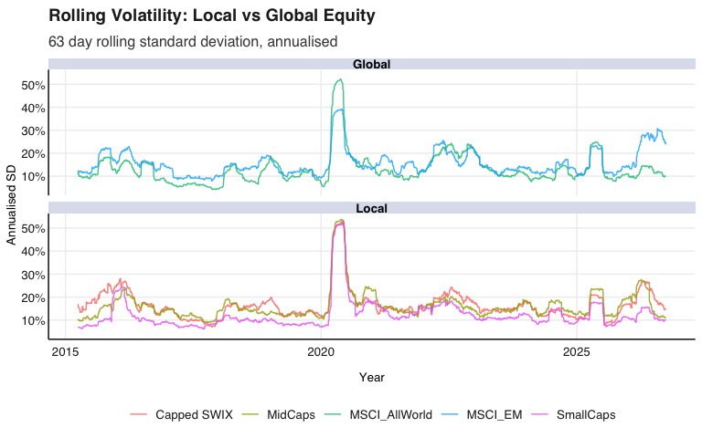
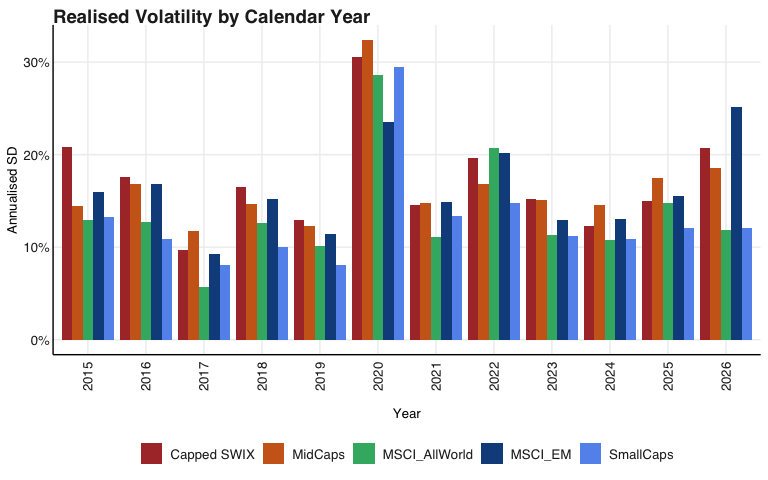
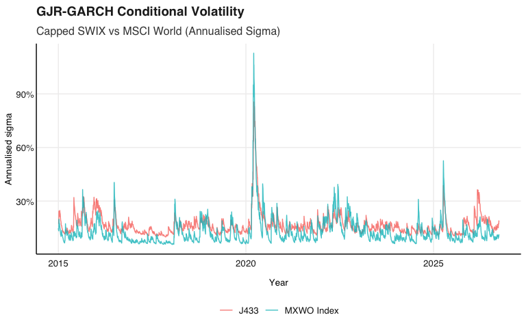
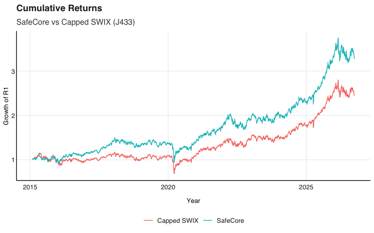
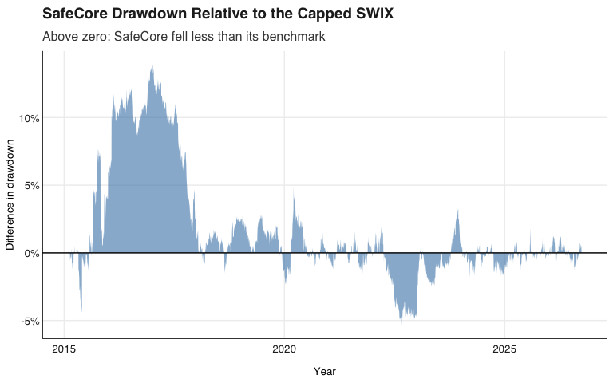
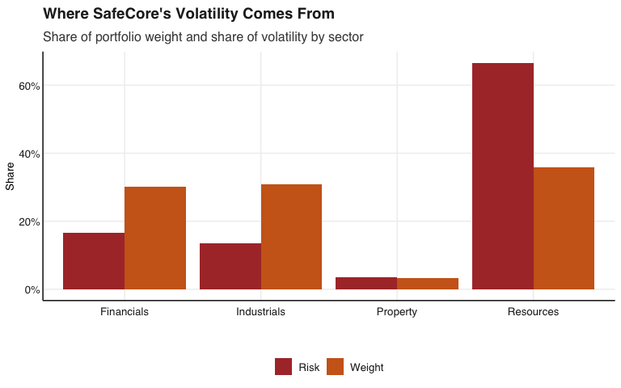
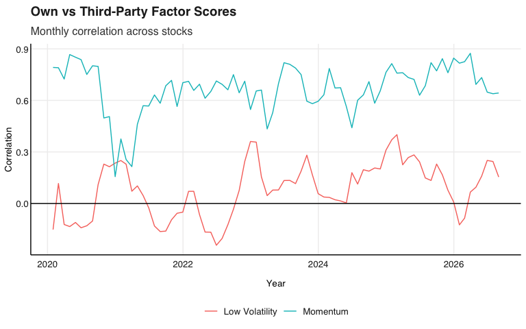
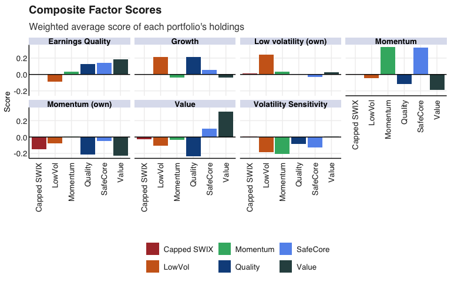
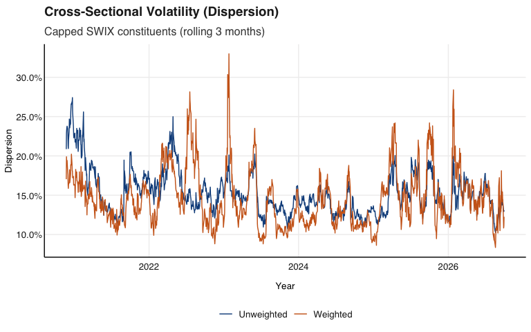
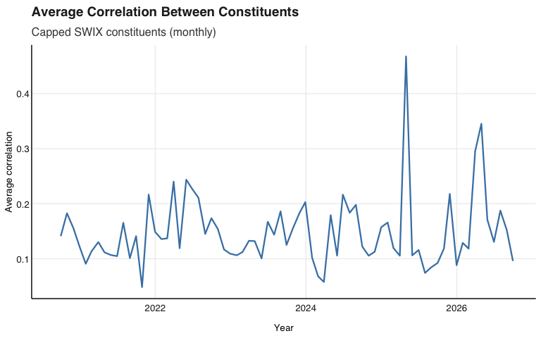

# Financial Econometrics Practical Exam 2026

Student number: 24693197

This README contains and describes all code used in the practical exam.
Functions are stored in each question’s `code/` folder (for example
`Questions/Question1/code/`) and are sourced in the relevant section
below. The write-ups (pdf, html or slides) are found in the `Questions/`
folders.

# Setup

The project was created with `fmxdat::make_project()`. The question
folders were created with Texevier’s folder functions. The chunk below
is not evaluated when knitting (`eval = F`), as re-running it would try
to create the folders again.

``` r
# Project root:
fmxdat::make_project()

# Question folders (PDF Texevier):
Texevier::create_template(directory = "Questions", template_name = "Question1",
                          build_project = TRUE, open_project = FALSE)

# HTML Texevier (research report for Question 2):
Texevier::create_template_html(directory = "Questions", template_name = "Question2",
                               build_project = TRUE, open_project = FALSE)

Texevier::create_template(directory = "Questions", template_name = "Question3",
                          build_project = TRUE, open_project = FALSE)

Texevier::create_template(directory = "Questions", template_name = "Question4",
                          build_project = TRUE, open_project = FALSE)
```

The exam data (`Prac26_Data.zip`) was unzipped into `data/` in the root
and the files used per question were copied into that question’s `data/`
folder. All `data` folders are excluded from Git in `.gitignore`.

``` r
# Hide package messages and warnings in the knitted README; fix default figure size:
knitr::opts_chunk$set(message = FALSE, warning = FALSE, fig.width = 8, fig.height = 5)

rm(list = ls()) # Clean your environment:
gc() # garbage collection
```

    ##           used (Mb) gc trigger (Mb) limit (Mb) max used (Mb)
    ## Ncells  567413 30.4    1263312 67.5         NA   715734 38.3
    ## Vcells 1088660  8.4    8388608 64.0      24576  2010785 15.4

``` r
pacman::p_load("xts", "tbl2xts", "PerformanceAnalytics", "lubridate", "glue", "RcppRoll", "gt", "rmsfuns", "rugarch", "rmgarch")
library(tidyverse)
```

    ## ── Attaching core tidyverse packages ──────────────────────── tidyverse 2.0.0 ──
    ## ✔ dplyr   1.2.1     ✔ readr   2.2.0
    ## ✔ forcats 1.0.1     ✔ stringr 1.6.0
    ## ✔ ggplot2 4.0.3     ✔ tibble  3.3.1
    ## ✔ purrr   1.2.2     ✔ tidyr   1.3.2
    ## ── Conflicts ────────────────────────────────────────── tidyverse_conflicts() ──
    ## ✖ dplyr::filter() masks stats::filter()
    ## ✖ dplyr::first()  masks rmgarch::first(), xts::first()
    ## ✖ dplyr::lag()    masks stats::lag()
    ## ✖ dplyr::last()   masks rmgarch::last(), xts::last()
    ## ✖ purrr::reduce() masks rugarch::reduce()
    ## ℹ Use the conflicted package (<http://conflicted.r-lib.org/>) to force all conflicts to become errors

``` r
if (!require("fmxdat")) pacman::p_install_gh("Nicktz/fmxdat")
```

    ## Loading required package: fmxdat

``` r
# Shared functions used across questions:
list.files('code/', full.names = T, recursive = T) %>% .[grepl('.R', .)] %>% as.list() %>% walk(~source(.))
```

# Question 1: Exploring Risk and Uncertainty

*Write-up* (Report) can be found at `Questions/Question1/Question1.pdf`

``` r
# Functions for this question:
list.files('Questions/Question1/code/', full.names = T, recursive = T) %>% .[grepl('.R', .)] %>% as.list() %>% walk(~source(.))
```

## Data

I only load the data I ended up using for this question.

``` r
Idx_Daily  <- read_rds("Questions/Question1/data/Index_Returns_Daily.rds")
MSCI <- read_rds("Questions/Question1/data/MSCI_Indexes.rds")
Uncertainty <- read_rds("Questions/Question1/data/Econ_Uncertainty_Indexes.rds")
SafeCore <- read_rds("Questions/Question1/data/SafeCore.rds")
Stocks <- read_rds("Questions/Question1/data/Stock_Returns_Daily.rds")
Cons <- read_rds("Questions/Question1/data/Index_Constituents.rds")
Factor_Scores <- read_rds("Questions/Question1/data/Factor_Scores.rds")
```

## Part A

My first thought was that Part A can really be further divided into two
parts. These parts are whether volatility has gone up, and whether it
moves with offshore markets. So I needed both local and global series on
the same footing.

For the local market I used the Capped SWIX (J433), since it is the
broad market index and also SafeCore’s benchmark. I added the Mid Cap
(J201) and Small Cap (J202) indexes because I wanted to see whether any
increase was only in the large companies or across the whole market. For
global markets I used MSCI World (developed markets) and MSCI Emerging
Markets, since South Africa is usually grouped with emerging markets. I
first converted the MSCI data to daily returns (since it is in levels)
and I started everything in 2015 because that is where the local data
starts.

``` r
Local_Rets <-
  Idx_Daily %>%
  filter(Tickers %in% c("J433", "J201", "J202"))

Global_Rets <-
  MSCI %>%
  filter(Ticker %in% c("MXWO Index", "MXEF Index")) %>%
  Q1_Level_to_Returns() %>%
  filter(date >= ymd(20150101))

Eq_Rets <- bind_rows(Local_Rets, Global_Rets)
```

I started with a rolling standard deviation to see how volatility
changes through time. I chose a 63 day window (about three months)
because it matches the three month horizon of the currency volatility
index in the data (it is also not too noisy). I annualised it with the
square root of 252 as is standard practice. I split the plot into local
and global panels so the two groups are easy to compare.

``` r
Roll_Vol <- Eq_Rets %>% Q1_Rolling_Vol(Window = 63)

g_roll <- Roll_Vol %>%
  mutate(Region = ifelse(Tickers %in% c("J433", "J201", "J202"), "Local", "Global")) %>%
  ggplot() +
  geom_line(aes(date, RollSD, color = Name), alpha = 0.8) +
  facet_wrap(~Region, ncol = 1) +
  labs(title = "Rolling Volatility: Local vs Global Equity",
       subtitle = "63 day rolling standard deviation, annualised",
       x = "Year", y = "Annualised SD") +
  fmxdat::theme_fmx()

fmxdat::finplot(g_roll, y.pct = T, y.pct_acc = 1)
```



The rolling plot showed that local and global volatility spike at the
same times, but it was hard to tell whether volatility had actually
increased over time. So I summarised volatility per calendar year, which
made it clear that volatility rises in episodes (and not steadily over
time).

``` r
Annual_Vol <- Eq_Rets %>%
  mutate(Year = format(date, "%Y")) %>%
  group_by(Name, Year) %>%
  summarise(SD = sd(Returns, na.rm = T) * sqrt(252)) %>% ungroup()

g_ann <- Annual_Vol %>%
  ggplot() +
  geom_bar(aes(Year, SD, fill = Name), stat = "identity", position = "dodge") +
  labs(title = "Realised Volatility by Calendar Year", x = "Year", y = "Annualised SD") +
  fmxdat::theme_fmx() + fmxdat::fmx_fills()

fmxdat::finplot(g_ann, y.pct = T, y.pct_acc = 1, x.vert = T)
```



A limitation of the rolling standard deviation is that one extreme day
affects the whole window. I wanted to check that the pattern still holds
once the noise is removed, so I fitted a GARCH model to the Capped SWIX
and MSCI World. I used a GJR-GARCH rather than a standard GARCH, because
the standard model treats positive and negative shocks the same, while
in stock markets negative returns tend to raise volatility by more. I
fitted the two indexes separately using `group_split` and `map`, and
cached the chunk since it takes a while to run.

``` r
Garch_Out <-
  Eq_Rets %>%
  filter(Tickers %in% c("J433", "MXWO Index")) %>%
  filter(!is.na(Returns)) %>%
  group_split(Tickers) %>%
  map(~Q1_Garch_Sigma(.))

g_garch <-
  Garch_Out %>% map_df(~.$Sigma) %>%
  ggplot() +
  geom_line(aes(date, sigma, color = Tickers), alpha = 0.8) +
  labs(title = "GJR-GARCH Conditional Volatility", subtitle = "Capped SWIX vs MSCI World (Annualised Sigma)",
       x = "Year", y = "Annualised sigma") +
  fmxdat::theme_fmx()

fmxdat::finplot(g_garch, y.pct = T, y.pct_acc = 1)
```



``` r
# Coefficient tables
Garch_Out[[1]]$Coefs
```

    ##            Estimate   Std. Error     t value     Pr(>|t|)
    ## mu     4.229070e-04 1.547252e-04  2.73327890 6.270721e-03
    ## ar1    9.299406e-04 1.850725e-02  0.05024738 9.599253e-01
    ## omega  3.520354e-06 1.022306e-06  3.44354281 5.741457e-04
    ## alpha1 4.333429e-03 4.047155e-03  1.07073474 2.842887e-01
    ## beta1  8.996543e-01 9.552136e-03 94.18358088 0.000000e+00
    ## gamma1 1.287942e-01 1.796874e-02  7.16768161 7.627232e-13
    ## shape  6.790450e+00 7.355812e-01  9.23140850 0.000000e+00

``` r
Garch_Out[[2]]$Coefs
```

    ##            Estimate   Std. Error     t value     Pr(>|t|)
    ## mu     6.008604e-04 1.167610e-04  5.14606897 2.660017e-07
    ## ar1    8.340800e-02 1.822163e-02  4.57741643 4.707538e-06
    ## omega  1.609155e-06 9.861849e-07  1.63169659 1.027434e-01
    ## alpha1 1.628387e-04 1.165105e-02  0.01397631 9.888489e-01
    ## beta1  8.632544e-01 1.602393e-02 53.87284195 0.000000e+00
    ## gamma1 2.349264e-01 3.629493e-02  6.47270479 9.626389e-11
    ## shape  6.050716e+00 6.356733e-01  9.51859446 0.000000e+00

The GARCH results confirmed the idea that the big global spikes allign
with local spikes. gamma1 is significant for both (so volatility reacts
mainly to negative returns) and persistence is close to one, so once
volatility increases it only settles after a long time.

## Part B

The question says volatility is not considered when SafeCore is built,
so my plan was to check three things. Firstly, how the fund has
performed and held up in down markets. Secondly, where its volatility
comes from, and lastly, what factors it is exposed to. This also follows
the structure set out by the question/the hints given to us (as far as I
know…).

SafeCore only gives monthly holdings, so I first had to build its daily
returns by applying the monthly weights to the daily stock returns
(using `Safe_Return.portfolio`). I used the Capped SWIX as the benchmark
throughout (as per the info given to us). I started with cumulative
returns to get an overall picture.

``` r
SafeCore_Rets <- Q1_SafeCore_Returns(Holdings = SafeCore, Stocks = Stocks)

BM_Rets <- Idx_Daily %>% filter(Tickers == "J433", date >= min(SafeCore_Rets$date))

g_cum <-
  bind_rows(SafeCore_Rets, BM_Rets) %>%
  arrange(date) %>%
  group_by(Name) %>%
  mutate(CP = cumprod(1 + Returns)) %>%
  ungroup() %>%
  ggplot() +
  geom_line(aes(date, CP, color = Name)) +
  labs(title = "Cumulative Returns", subtitle = "SafeCore vs Capped SWIX (J433)", x = "Year", y = "Growth of R1") +
  fmxdat::theme_fmx()

fmxdat::finplot(g_cum)
```



SafeCore clearly outperformed! But, alas, the question is about
volatility. Thus, I needed risk measures as well. I used the general
financial stats table function, which I set up once in the root `code/`
folder so I can reuse it. It needs monthly returns, so I converted the
daily returns to monthly first. I looked at the last 3 and 5 years to
focus on how the fund has behaved recently.

``` r
Monthly_Rets <-
  bind_rows(SafeCore_Rets, BM_Rets) %>%
  arrange(date) %>%
  group_by(Tickers) %>%
  mutate(Index = cumprod(1 + Returns)) %>%
  mutate(Yearmonth = format(date, "%Y%B")) %>%
  group_by(Tickers, Yearmonth) %>%
  filter(date == last(date)) %>%
  group_by(Tickers) %>%
  mutate(Ret = Index / lag(Index) - 1) %>%
  ungroup() %>%
  filter(!is.na(Ret)) %>%
  select(date, Tickers, Ret)

Tab_stats <-
  bind_rows(
    Moments_Comp(Monthly_Rets, BM = "J433", Yrs_LookBack = 3, NA_Check = 0.8),
    Moments_Comp(Monthly_Rets, BM = "J433", Yrs_LookBack = 5, NA_Check = 0.8)
  )

Format_Stats_Table(Tab_stats, BM = "J433")
```

<div id="gmhxcfxddr" style="padding-left:0px;padding-right:0px;padding-top:10px;padding-bottom:10px;overflow-x:auto;overflow-y:auto;width:auto;height:auto;">
<style>#gmhxcfxddr table {
  font-family: system-ui, 'Segoe UI', Roboto, Helvetica, Arial, sans-serif, 'Apple Color Emoji', 'Segoe UI Emoji', 'Segoe UI Symbol', 'Noto Color Emoji';
  -webkit-font-smoothing: antialiased;
  -moz-osx-font-smoothing: grayscale;
}

#gmhxcfxddr thead, #gmhxcfxddr tbody, #gmhxcfxddr tfoot, #gmhxcfxddr tr, #gmhxcfxddr td, #gmhxcfxddr th {
  border-style: none;
}

#gmhxcfxddr p {
  margin: 0;
  padding: 0;
}

#gmhxcfxddr .gt_table {
  display: table;
  border-collapse: collapse;
  line-height: normal;
  margin-left: auto;
  margin-right: auto;
  color: #333333;
  font-size: 16px;
  font-weight: normal;
  font-style: normal;
  background-color: #FFFFFF;
  width: auto;
  border-top-style: solid;
  border-top-width: 2px;
  border-top-color: #A8A8A8;
  border-right-style: none;
  border-right-width: 2px;
  border-right-color: #D3D3D3;
  border-bottom-style: solid;
  border-bottom-width: 2px;
  border-bottom-color: #A8A8A8;
  border-left-style: none;
  border-left-width: 2px;
  border-left-color: #D3D3D3;
}

#gmhxcfxddr .gt_caption {
  padding-top: 4px;
  padding-bottom: 4px;
}

#gmhxcfxddr .gt_title {
  color: #333333;
  font-size: 125%;
  font-weight: initial;
  padding-top: 4px;
  padding-bottom: 4px;
  padding-left: 5px;
  padding-right: 5px;
  border-bottom-color: #FFFFFF;
  border-bottom-width: 0;
}

#gmhxcfxddr .gt_subtitle {
  color: #333333;
  font-size: 85%;
  font-weight: initial;
  padding-top: 3px;
  padding-bottom: 5px;
  padding-left: 5px;
  padding-right: 5px;
  border-top-color: #FFFFFF;
  border-top-width: 0;
}

#gmhxcfxddr .gt_heading {
  background-color: #FFFFFF;
  text-align: center;
  border-bottom-color: #FFFFFF;
  border-left-style: none;
  border-left-width: 1px;
  border-left-color: #D3D3D3;
  border-right-style: none;
  border-right-width: 1px;
  border-right-color: #D3D3D3;
}

#gmhxcfxddr .gt_bottom_border {
  border-bottom-style: solid;
  border-bottom-width: 2px;
  border-bottom-color: #D3D3D3;
}

#gmhxcfxddr .gt_col_headings {
  border-top-style: solid;
  border-top-width: 2px;
  border-top-color: #D3D3D3;
  border-bottom-style: solid;
  border-bottom-width: 2px;
  border-bottom-color: #D3D3D3;
  border-left-style: none;
  border-left-width: 1px;
  border-left-color: #D3D3D3;
  border-right-style: none;
  border-right-width: 1px;
  border-right-color: #D3D3D3;
}

#gmhxcfxddr .gt_col_heading {
  color: #333333;
  background-color: #FFFFFF;
  font-size: 100%;
  font-weight: normal;
  text-transform: inherit;
  border-left-style: none;
  border-left-width: 1px;
  border-left-color: #D3D3D3;
  border-right-style: none;
  border-right-width: 1px;
  border-right-color: #D3D3D3;
  vertical-align: bottom;
  padding-top: 5px;
  padding-bottom: 6px;
  padding-left: 5px;
  padding-right: 5px;
  overflow-x: hidden;
}

#gmhxcfxddr .gt_column_spanner_outer {
  color: #333333;
  background-color: #FFFFFF;
  font-size: 100%;
  font-weight: normal;
  text-transform: inherit;
  padding-top: 0;
  padding-bottom: 0;
  padding-left: 4px;
  padding-right: 4px;
}

#gmhxcfxddr .gt_column_spanner_outer:first-child {
  padding-left: 0;
}

#gmhxcfxddr .gt_column_spanner_outer:last-child {
  padding-right: 0;
}

#gmhxcfxddr .gt_column_spanner {
  border-bottom-style: solid;
  border-bottom-width: 2px;
  border-bottom-color: #D3D3D3;
  vertical-align: bottom;
  padding-top: 5px;
  padding-bottom: 5px;
  overflow-x: hidden;
  display: inline-block;
  width: 100%;
}

#gmhxcfxddr .gt_spanner_row {
  border-bottom-style: hidden;
}

#gmhxcfxddr .gt_group_heading {
  padding-top: 8px;
  padding-bottom: 8px;
  padding-left: 5px;
  padding-right: 5px;
  color: #333333;
  background-color: #FFFFFF;
  font-size: 100%;
  font-weight: initial;
  text-transform: inherit;
  border-top-style: solid;
  border-top-width: 2px;
  border-top-color: #D3D3D3;
  border-bottom-style: solid;
  border-bottom-width: 2px;
  border-bottom-color: #D3D3D3;
  border-left-style: none;
  border-left-width: 1px;
  border-left-color: #D3D3D3;
  border-right-style: none;
  border-right-width: 1px;
  border-right-color: #D3D3D3;
  vertical-align: middle;
  text-align: left;
}

#gmhxcfxddr .gt_empty_group_heading {
  padding: 0.5px;
  color: #333333;
  background-color: #FFFFFF;
  font-size: 100%;
  font-weight: initial;
  border-top-style: solid;
  border-top-width: 2px;
  border-top-color: #D3D3D3;
  border-bottom-style: solid;
  border-bottom-width: 2px;
  border-bottom-color: #D3D3D3;
  vertical-align: middle;
}

#gmhxcfxddr .gt_from_md > :first-child {
  margin-top: 0;
}

#gmhxcfxddr .gt_from_md > :last-child {
  margin-bottom: 0;
}

#gmhxcfxddr .gt_row {
  padding-top: 8px;
  padding-bottom: 8px;
  padding-left: 5px;
  padding-right: 5px;
  margin: 10px;
  border-top-style: solid;
  border-top-width: 1px;
  border-top-color: #D3D3D3;
  border-left-style: none;
  border-left-width: 1px;
  border-left-color: #D3D3D3;
  border-right-style: none;
  border-right-width: 1px;
  border-right-color: #D3D3D3;
  vertical-align: middle;
  overflow-x: hidden;
}

#gmhxcfxddr .gt_stub {
  color: #333333;
  background-color: #FFFFFF;
  font-size: 100%;
  font-weight: initial;
  text-transform: inherit;
  border-right-style: solid;
  border-right-width: 2px;
  border-right-color: #D3D3D3;
  padding-left: 5px;
  padding-right: 5px;
}

#gmhxcfxddr .gt_stub_row_group {
  color: #333333;
  background-color: #FFFFFF;
  font-size: 100%;
  font-weight: initial;
  text-transform: inherit;
  border-right-style: solid;
  border-right-width: 2px;
  border-right-color: #D3D3D3;
  padding-left: 5px;
  padding-right: 5px;
  vertical-align: top;
}

#gmhxcfxddr .gt_row_group_first td {
  border-top-width: 2px;
}

#gmhxcfxddr .gt_row_group_first th {
  border-top-width: 2px;
}

#gmhxcfxddr .gt_summary_row {
  color: #333333;
  background-color: #FFFFFF;
  text-transform: inherit;
  padding-top: 8px;
  padding-bottom: 8px;
  padding-left: 5px;
  padding-right: 5px;
}

#gmhxcfxddr .gt_first_summary_row {
  border-top-style: solid;
  border-top-color: #D3D3D3;
}

#gmhxcfxddr .gt_first_summary_row.thick {
  border-top-width: 2px;
}

#gmhxcfxddr .gt_last_summary_row {
  padding-top: 8px;
  padding-bottom: 8px;
  padding-left: 5px;
  padding-right: 5px;
  border-bottom-style: solid;
  border-bottom-width: 2px;
  border-bottom-color: #D3D3D3;
}

#gmhxcfxddr .gt_grand_summary_row {
  color: #333333;
  background-color: #FFFFFF;
  text-transform: inherit;
  padding-top: 8px;
  padding-bottom: 8px;
  padding-left: 5px;
  padding-right: 5px;
}

#gmhxcfxddr .gt_first_grand_summary_row {
  padding-top: 8px;
  padding-bottom: 8px;
  padding-left: 5px;
  padding-right: 5px;
  border-top-style: double;
  border-top-width: 6px;
  border-top-color: #D3D3D3;
}

#gmhxcfxddr .gt_last_grand_summary_row_top {
  padding-top: 8px;
  padding-bottom: 8px;
  padding-left: 5px;
  padding-right: 5px;
  border-bottom-style: double;
  border-bottom-width: 6px;
  border-bottom-color: #D3D3D3;
}

#gmhxcfxddr .gt_striped {
  background-color: rgba(128, 128, 128, 0.05);
}

#gmhxcfxddr .gt_table_body {
  border-top-style: solid;
  border-top-width: 2px;
  border-top-color: #D3D3D3;
  border-bottom-style: solid;
  border-bottom-width: 2px;
  border-bottom-color: #D3D3D3;
}

#gmhxcfxddr .gt_footnotes {
  color: #333333;
  background-color: #FFFFFF;
  border-bottom-style: none;
  border-bottom-width: 2px;
  border-bottom-color: #D3D3D3;
  border-left-style: none;
  border-left-width: 2px;
  border-left-color: #D3D3D3;
  border-right-style: none;
  border-right-width: 2px;
  border-right-color: #D3D3D3;
}

#gmhxcfxddr .gt_footnote {
  margin: 0px;
  font-size: 90%;
  padding-top: 4px;
  padding-bottom: 4px;
  padding-left: 5px;
  padding-right: 5px;
}

#gmhxcfxddr .gt_sourcenotes {
  color: #333333;
  background-color: #FFFFFF;
  border-bottom-style: none;
  border-bottom-width: 2px;
  border-bottom-color: #D3D3D3;
  border-left-style: none;
  border-left-width: 2px;
  border-left-color: #D3D3D3;
  border-right-style: none;
  border-right-width: 2px;
  border-right-color: #D3D3D3;
}

#gmhxcfxddr .gt_sourcenote {
  font-size: 90%;
  padding-top: 4px;
  padding-bottom: 4px;
  padding-left: 5px;
  padding-right: 5px;
}

#gmhxcfxddr .gt_left {
  text-align: left;
}

#gmhxcfxddr .gt_center {
  text-align: center;
}

#gmhxcfxddr .gt_right {
  text-align: right;
  font-variant-numeric: tabular-nums;
}

#gmhxcfxddr .gt_font_normal {
  font-weight: normal;
}

#gmhxcfxddr .gt_font_bold {
  font-weight: bold;
}

#gmhxcfxddr .gt_font_italic {
  font-style: italic;
}

#gmhxcfxddr .gt_super {
  font-size: 65%;
}

#gmhxcfxddr .gt_footnote_marks {
  font-size: 75%;
  vertical-align: 0.4em;
  position: initial;
}

#gmhxcfxddr .gt_asterisk {
  font-size: 100%;
  vertical-align: 0;
}

#gmhxcfxddr .gt_indent_1 {
  text-indent: 5px;
}

#gmhxcfxddr .gt_indent_2 {
  text-indent: 10px;
}

#gmhxcfxddr .gt_indent_3 {
  text-indent: 15px;
}

#gmhxcfxddr .gt_indent_4 {
  text-indent: 20px;
}

#gmhxcfxddr .gt_indent_5 {
  text-indent: 25px;
}

#gmhxcfxddr .katex-display {
  display: inline-flex !important;
  margin-bottom: 0.75em !important;
}

#gmhxcfxddr div.Reactable > div.rt-table > div.rt-thead > div.rt-tr.rt-tr-group-header > div.rt-th-group:after {
  height: 0px !important;
}
</style>
<table class="gt_table" data-quarto-disable-processing="false" data-quarto-bootstrap="false">
  <caption>Fund Moments Comparison</caption>
  <thead>
    <tr class="gt_heading">
      <td colspan="3" class="gt_heading gt_title gt_font_normal gt_bottom_border" style>Index Statistics: Relative to J433</td>
    </tr>
    
    <tr class="gt_col_headings">
      <th class="gt_col_heading gt_columns_bottom_border gt_left" rowspan="1" colspan="1" scope="col" id="Info">Info</th>
      <th class="gt_col_heading gt_columns_bottom_border gt_right" rowspan="1" colspan="1" scope="col" id="SafeCore">SafeCore</th>
      <th class="gt_col_heading gt_columns_bottom_border gt_right" rowspan="1" colspan="1" scope="col" id="J433">J433</th>
    </tr>
  </thead>
  <tbody class="gt_table_body">
    <tr class="gt_group_heading_row">
      <th colspan="3" class="gt_group_heading" style="background-color: rgba(69,69,69,0.15); font-size: large; text-align: left; font-weight: bold;" scope="colgroup" id="Last-3-Years">Last 3 Years</th>
    </tr>
    <tr class="gt_row_group_first"><td headers="Last-3-Years  Info" class="gt_row gt_left">Cum Returns</td>
<td headers="Last-3-Years  SafeCore" class="gt_row gt_right">76.0%</td>
<td headers="Last-3-Years  J433" class="gt_row gt_right">69.6%</td></tr>
    <tr><td headers="Last-3-Years  Info" class="gt_row gt_left">Returns (Ann.)</td>
<td headers="Last-3-Years  SafeCore" class="gt_row gt_right">20.7%</td>
<td headers="Last-3-Years  J433" class="gt_row gt_right">19.3%</td></tr>
    <tr><td headers="Last-3-Years  Info" class="gt_row gt_left">Returns Excess (Ann.)</td>
<td headers="Last-3-Years  SafeCore" class="gt_row gt_right">1.2%</td>
<td headers="Last-3-Years  J433" class="gt_row gt_right">0.0%</td></tr>
    <tr><td headers="Last-3-Years  Info" class="gt_row gt_left">SD (Ann.)</td>
<td headers="Last-3-Years  SafeCore" class="gt_row gt_right">13.4%</td>
<td headers="Last-3-Years  J433" class="gt_row gt_right">12.8%</td></tr>
    <tr><td headers="Last-3-Years  Info" class="gt_row gt_left">Adj. Sharpe Ratio</td>
<td headers="Last-3-Years  SafeCore" class="gt_row gt_right">1.157</td>
<td headers="Last-3-Years  J433" class="gt_row gt_right">0.853</td></tr>
    <tr><td headers="Last-3-Years  Info" class="gt_row gt_left">Pain Index</td>
<td headers="Last-3-Years  SafeCore" class="gt_row gt_right">0.028</td>
<td headers="Last-3-Years  J433" class="gt_row gt_right">0.026</td></tr>
    <tr><td headers="Last-3-Years  Info" class="gt_row gt_left">Avg DD</td>
<td headers="Last-3-Years  SafeCore" class="gt_row gt_right">6.1%</td>
<td headers="Last-3-Years  J433" class="gt_row gt_right">4.7%</td></tr>
    <tr><td headers="Last-3-Years  Info" class="gt_row gt_left">Tracking Error</td>
<td headers="Last-3-Years  SafeCore" class="gt_row gt_right">3.2%</td>
<td headers="Last-3-Years  J433" class="gt_row gt_right">0.0%</td></tr>
    <tr><td headers="Last-3-Years  Info" class="gt_row gt_left">Information Ratio</td>
<td headers="Last-3-Years  SafeCore" class="gt_row gt_right">0.460</td>
<td headers="Last-3-Years  J433" class="gt_row gt_right">-</td></tr>
    <tr><td headers="Last-3-Years  Info" class="gt_row gt_left">Beta</td>
<td headers="Last-3-Years  SafeCore" class="gt_row gt_right">1.018</td>
<td headers="Last-3-Years  J433" class="gt_row gt_right">1.000</td></tr>
    <tr><td headers="Last-3-Years  Info" class="gt_row gt_left">Beta Bull</td>
<td headers="Last-3-Years  SafeCore" class="gt_row gt_right">1.072</td>
<td headers="Last-3-Years  J433" class="gt_row gt_right">1.000</td></tr>
    <tr><td headers="Last-3-Years  Info" class="gt_row gt_left">Beta Bear</td>
<td headers="Last-3-Years  SafeCore" class="gt_row gt_right">0.838</td>
<td headers="Last-3-Years  J433" class="gt_row gt_right">1.000</td></tr>
    <tr><td headers="Last-3-Years  Info" class="gt_row gt_left">Up-Down Ratio</td>
<td headers="Last-3-Years  SafeCore" class="gt_row gt_right">0.680</td>
<td headers="Last-3-Years  J433" class="gt_row gt_right">0.000</td></tr>
    <tr><td headers="Last-3-Years  Info" class="gt_row gt_left">Modified CVaR</td>
<td headers="Last-3-Years  SafeCore" class="gt_row gt_right">-0.076</td>
<td headers="Last-3-Years  J433" class="gt_row gt_right">-0.083</td></tr>
    <tr class="gt_group_heading_row">
      <th colspan="3" class="gt_group_heading" style="background-color: rgba(69,69,69,0.15); font-size: large; text-align: left; font-weight: bold;" scope="colgroup" id="Last-5-Years">Last 5 Years</th>
    </tr>
    <tr class="gt_row_group_first"><td headers="Last-5-Years  Info" class="gt_row gt_left">Cum Returns</td>
<td headers="Last-5-Years  SafeCore" class="gt_row gt_right">97.7%</td>
<td headers="Last-5-Years  J433" class="gt_row gt_right">91.9%</td></tr>
    <tr><td headers="Last-5-Years  Info" class="gt_row gt_left">Returns (Ann.)</td>
<td headers="Last-5-Years  SafeCore" class="gt_row gt_right">14.6%</td>
<td headers="Last-5-Years  J433" class="gt_row gt_right">13.9%</td></tr>
    <tr><td headers="Last-5-Years  Info" class="gt_row gt_left">Returns Excess (Ann.)</td>
<td headers="Last-5-Years  SafeCore" class="gt_row gt_right">0.6%</td>
<td headers="Last-5-Years  J433" class="gt_row gt_right">0.0%</td></tr>
    <tr><td headers="Last-5-Years  Info" class="gt_row gt_left">SD (Ann.)</td>
<td headers="Last-5-Years  SafeCore" class="gt_row gt_right">14.8%</td>
<td headers="Last-5-Years  J433" class="gt_row gt_right">13.7%</td></tr>
    <tr><td headers="Last-5-Years  Info" class="gt_row gt_left">Adj. Sharpe Ratio</td>
<td headers="Last-5-Years  SafeCore" class="gt_row gt_right">0.933</td>
<td headers="Last-5-Years  J433" class="gt_row gt_right">0.918</td></tr>
    <tr><td headers="Last-5-Years  Info" class="gt_row gt_left">Pain Index</td>
<td headers="Last-5-Years  SafeCore" class="gt_row gt_right">0.040</td>
<td headers="Last-5-Years  J433" class="gt_row gt_right">0.032</td></tr>
    <tr><td headers="Last-5-Years  Info" class="gt_row gt_left">Avg DD</td>
<td headers="Last-5-Years  SafeCore" class="gt_row gt_right">9.8%</td>
<td headers="Last-5-Years  J433" class="gt_row gt_right">6.9%</td></tr>
    <tr><td headers="Last-5-Years  Info" class="gt_row gt_left">Tracking Error</td>
<td headers="Last-5-Years  SafeCore" class="gt_row gt_right">3.5%</td>
<td headers="Last-5-Years  J433" class="gt_row gt_right">0.0%</td></tr>
    <tr><td headers="Last-5-Years  Info" class="gt_row gt_left">Information Ratio</td>
<td headers="Last-5-Years  SafeCore" class="gt_row gt_right">0.193</td>
<td headers="Last-5-Years  J433" class="gt_row gt_right">-</td></tr>
    <tr><td headers="Last-5-Years  Info" class="gt_row gt_left">Beta</td>
<td headers="Last-5-Years  SafeCore" class="gt_row gt_right">1.053</td>
<td headers="Last-5-Years  J433" class="gt_row gt_right">1.000</td></tr>
    <tr><td headers="Last-5-Years  Info" class="gt_row gt_left">Beta Bull</td>
<td headers="Last-5-Years  SafeCore" class="gt_row gt_right">0.997</td>
<td headers="Last-5-Years  J433" class="gt_row gt_right">1.000</td></tr>
    <tr><td headers="Last-5-Years  Info" class="gt_row gt_left">Beta Bear</td>
<td headers="Last-5-Years  SafeCore" class="gt_row gt_right">0.905</td>
<td headers="Last-5-Years  J433" class="gt_row gt_right">1.000</td></tr>
    <tr><td headers="Last-5-Years  Info" class="gt_row gt_left">Up-Down Ratio</td>
<td headers="Last-5-Years  SafeCore" class="gt_row gt_right">0.615</td>
<td headers="Last-5-Years  J433" class="gt_row gt_right">0.000</td></tr>
    <tr><td headers="Last-5-Years  Info" class="gt_row gt_left">Modified CVaR</td>
<td headers="Last-5-Years  SafeCore" class="gt_row gt_right">-0.081</td>
<td headers="Last-5-Years  J433" class="gt_row gt_right">-0.079</td></tr>
  </tbody>
  
</table>
</div>

The stats table showed higher volatility and deeper average drawdowns
recently. When volatility rises, the losses are what matter most, so I
also looked at downside risk measures over the full period. These
pointed the other way (SafeCore had lower downside risk overall), so I
plotted the difference in drawdown over time to see when this changed.
This showed that SafeCore’s protection was mostly in earlier years and
has faded since 2021.

``` r
tabdownside <-
  table.DownsideRisk(left_join(SafeCore_Rets %>% select(date, SafeCore = Returns),
                               BM_Rets %>% select(date, J433 = Returns),
                               by = "date") %>% tbl_xts(.),
                     ci = 0.95, Rf = 0, MAR = 0)

tabdownside[c(1,5,7,8:11),]
```

    ##                            SafeCore    J433
    ## Semi Deviation               0.0078  0.0081
    ## Downside Deviation (Rf=0%)   0.0076  0.0080
    ## Maximum Drawdown             0.3765  0.4166
    ## Historical VaR (95%)        -0.0163 -0.0165
    ## Historical ES (95%)         -0.0244 -0.0257
    ## Modified VaR (95%)          -0.0175 -0.0179
    ## Modified ES (95%)           -0.0310 -0.0349

``` r
DD <-
  bind_rows(SafeCore_Rets, BM_Rets) %>%
  arrange(date) %>%
  group_by(Name) %>%
  mutate(CP = cumprod(1 + Returns)) %>%
  mutate(Drawdown = CP / cummax(CP) - 1) %>%
  ungroup() %>%
  select(date, Name, Drawdown) %>%
  spread(Name, Drawdown) %>%
  mutate(Diff = SafeCore - `Capped SWIX`) %>%
  filter(!is.na(Diff))

g_dd <-
  DD %>%
  ggplot() +
  geom_ribbon(aes(date, ymin = 0, ymax = Diff), fill = "steelblue", alpha = 0.6) +
  geom_hline(yintercept = 0) +
  labs(title = "SafeCore Drawdown Relative to the Capped SWIX",
       subtitle = "Above zero: SafeCore fell less than its benchmark",
       x = "Year", y = "Difference in drawdown") +
  fmxdat::theme_fmx()

fmxdat::finplot(g_dd, y.pct = T, y.pct_acc = 1)
```



Next, we were asked to investigate where SafeCore’s volatility comes
from. A stock’s weight does not tell you how much risk it adds, because
that also depends on how volatile it is and how it moves with the rest
of the fund. So I calculated each stock’s contribution to the portfolio
standard deviation over the last 12 months, using the average weights
over that year. I then grouped this by sector and compared each sector’s
share of the weight with its share of the risk. Two stocks (PAN and VAL)
had no sector in the SafeCore data, so I checked the index constituent
data and classified both as Resources.

``` r
Risk_Contrib <- Q1_Risk_Contrib(Holdings = SafeCore, Stocks = Stocks, Months = 12)

Sectors <-
  SafeCore %>%
  group_by(Tickers) %>%
  filter(date == max(date)) %>%
  ungroup() %>%
  select(Tickers, Sector)

Risk_Sector <-
  Risk_Contrib %>%
  left_join(Sectors, by = "Tickers") %>%
  # PAN and VAL have no sector in the SafeCore data but Index_Constituents lists both as Resources
  mutate(Sector = ifelse(Tickers %in% c("PAN", "VAL"), "Resources", Sector)) %>%
  group_by(Sector) %>%
  summarise(Weight = sum(wt), Risk = sum(Risk_Contrib)) %>%
  gather(Measure, Share, Weight, Risk)

g_risk <-
  Risk_Sector %>%
  ggplot() +
  geom_bar(aes(Sector, Share, fill = Measure), stat = "identity", position = "dodge") +
  labs(title = "Where SafeCore's Volatility Comes From",
       subtitle = "Share of portfolio weight and share of volatility by sector",
       x = "", y = "Share") +
  fmxdat::theme_fmx() + fmxdat::fmx_fills()

fmxdat::finplot(g_risk, y.pct = T, y.pct_acc = 1)
```



Resources turned out to be about a third of the fund but around two
thirds of its volatility, which links back to Part A, since resource
stocks depend on global commodity prices and are exposed to offshore
shockss.

For the factor exposures, the question asks for my own momentum and low
volatility scores. For momentum I used the six month return excluding
the most recent month, so that the score reflects a more persistent
trend rather than the latest short-term move. For low volatility I used
six months of daily realised volatility, reusing my rolling volatility
function from Part A with a 126 day window. I flipped the sign so that
less volatile stocks get a higher score and standardised both scores
each month with `scale()` so they are on the same scale as the
third-party scores. I then checked how closely my scores line up with
the third-party ones each month.

``` r
Own_LowVol <-
  Stocks %>%
  Q1_Rolling_Vol(Window = 126) %>%
  mutate(YM = format(date, "%Y%B")) %>%
  group_by(Tickers, YM) %>%
  filter(date == last(date)) %>%
  ungroup() %>%
  select(YM, Tickers, LowVol = RollSD)

Stock_Monthly <-
  Stocks %>%
  arrange(date) %>%
  group_by(Tickers) %>%
  mutate(Index = cumprod(1 + coalesce(Returns, 0))) %>%
  mutate(YM = format(date, "%Y%B")) %>%
  group_by(Tickers, YM) %>%
  filter(date == last(date)) %>%
  group_by(Tickers) %>%
  mutate(Ret = Index / lag(Index) - 1) %>%
  ungroup()

Own_Mom <-
  Stock_Monthly %>%
  group_by(Tickers) %>%
  mutate(Mom = lag(RcppRoll::roll_prod(1 + Ret, n = 6, fill = NA, align = "right")) - 1) %>%
  ungroup() %>%
  select(YM, Tickers, Mom)

Scores <-
  inner_join(Own_Mom, Own_LowVol, by = c("YM", "Tickers")) %>%
  filter(!is.na(Mom), !is.na(LowVol)) %>%
  group_by(YM) %>%
  mutate(Own_Momentum = as.numeric(scale(Mom)),
         Own_LowVol = as.numeric(scale(-LowVol))) %>%
  ungroup() %>%
  inner_join(Factor_Scores %>% mutate(YM = format(date, "%Y%B")) %>% spread(Factor, Factor_Value),
             by = c("YM", "Tickers"))

g_cor <-
  Scores %>%
  group_by(YM) %>%
  summarise(date = max(date),
            Momentum = cor(Own_Momentum, Momentum, use = "complete.obs"),
            `Low Volatility` = cor(Own_LowVol, `Volatility Sensitivity`, use = "complete.obs")) %>%
  select(-YM) %>%
  gather(Factor, Correlation, -date) %>%
  ggplot() +
  geom_line(aes(date, Correlation, color = Factor)) +
  geom_hline(yintercept = 0) +
  labs(title = "Own vs Third-Party Factor Scores",
       subtitle = "Monthly correlation across stocks", x = "Year", y = "Correlation") +
  fmxdat::theme_fmx()

fmxdat::finplot(g_cor)
```



The question asks for composite scores for different strategies to
contextualise SafeCore’s scores, so I turned them into a portfolio score
by taking the weighted average score of each portfolio’s holdings in the
latest month. To give SafeCore’s scores some context, I did the same for
the Capped SWIX and the strategy indexes in the constituent data. This
also worked as a check because each strategy index should score highest
on its own factor, and the Capped SWIX should be close to zero.

``` r
Last_Date <- max(SafeCore$date)

Weights <-
  bind_rows(
    SafeCore %>%
      filter(date == Last_Date) %>%
      select(Tickers, weight = Weight) %>%
      mutate(Portfolio = "SafeCore"),
    Cons %>%
      filter(date == Last_Date, Index %in% c("Capped SWIX", "LowVol", "Momentum", "Value", "Quality")) %>%
      select(Tickers, weight, Portfolio = Index)
  )

Composite <-
  Weights %>%
  left_join(Scores %>% filter(date == Last_Date), by = "Tickers") %>%
  group_by(Portfolio) %>%
  summarise(`Momentum (own)` = sum(weight * Own_Momentum, na.rm = T),
            `Low volatility (own)` = sum(weight * Own_LowVol, na.rm = T),
            Momentum = sum(weight * Momentum, na.rm = T),
            `Volatility Sensitivity` = sum(weight * `Volatility Sensitivity`, na.rm = T),
            Value = sum(weight * Value, na.rm = T),
            Growth = sum(weight * Growth, na.rm = T),
            `Earnings Quality` = sum(weight * `Earnings Quality`, na.rm = T)) %>%
  gather(Factor, Score, -Portfolio)

g_comp <-
  Composite %>%
  ggplot() +
  geom_bar(aes(Portfolio, Score, fill = Portfolio), stat = "identity") +
  geom_hline(yintercept = 0) +
  facet_wrap(~Factor, nrow = 2) +
  labs(title = "Composite Factor Scores",
       subtitle = "Weighted average score of each portfolio's holdings", x = "", y = "Score") +
  fmxdat::theme_fmx() + fmxdat::fmx_fills()

fmxdat::finplot(g_comp, x.vert = T)
```



SafeCore came out with a strong momentum tilt and no low volatility
tilt.

## Part C

Here the question asks about the alpha opportunity since 2020 and how it
changes with global macro factors. I used three pieces: dispersion, the
average correlation between stocks, and a split by global uncertainty.

Dispersion measures how far constituent returns spread around the index
return, so high dispersion means more room for active managers to
differentiate their portfolios. I used the dispersion function with a
rolling 60 day (three month) window. I chose the weighted measure as my
main one because SafeCore is managed against the Capped SWIX, so the
opportunity that matters is the one relative to the index as it is
actually weighted. I kept the unweighted measure on the plot for
comparison. The constituent data starts in August 2020, so this covers
the full period available since 2020.

``` r
J433_Cons <- Cons %>% filter(Index == "Capped SWIX")

BM <- Idx_Daily %>% filter(Tickers == "J433") %>% select(date, BM = Returns)

m3_disp <- Dispersion_Prep(df_used = J433_Cons, BMUse = BM, BMSel = "weight", NSel = 60) %>%
  filter(date >= ymd(20200101))

g_disp <-
  m3_disp %>%
  gather(Type, Value, starts_with("Dispersion")) %>%
  mutate(Type = ifelse(Type == "Dispersion_W", "Weighted", "Unweighted")) %>%
  ggplot() +
  geom_line(aes(date, Value, color = Type)) +
  labs(title = "Cross-Sectional Volatility (Dispersion)",
       subtitle = "Capped SWIX constituents (rolling 3 months)", x = "Year", y = "Dispersion") +
  fmxdat::theme_fmx() + fmxdat::fmx_cols()

fmxdat::finplot(g_disp, y.pct = T)
```



Dispersion tells you how far apart returns are, but not whether stocks
move in the same direction, so I also looked at correlations. For each
month I built the correlation matrix of the constituents’ daily returns
and took the average across all pairs of stocks (leaving out the
diagonal, since a stock is always perfectly correlated with itself). I
wrote the function for one month and mapped it over all months.

``` r
Avg_Cor <- J433_Cons %>% fmxdat::YM() %>% group_split(YM) %>% map_df(~Q1_Month_Cor(.)) %>%
  filter(date >= ymd(20200101))

g_avgcor <-
  Avg_Cor %>%
  ggplot() +
  geom_line(aes(date, Avg_Cor), colour = "steelblue", linewidth = 0.8) +
  labs(title = "Average Correlation Between Constituents",
       subtitle = "Capped SWIX constituents (monthly)", x = "Year", y = "Average correlation") +
  fmxdat::theme_fmx()

fmxdat::finplot(g_avgcor)
```



Finally, to link the alpha opportunity to a global macro factor, Since
the seminar in the question focused on global policy uncertainty, I used
the global economic policy uncertainty index. I split the months into
high uncertainty (above the 85th percentile), low uncertainty (below the
25th percentile) and other and compared average dispersion and
correlation in each group. I joined everything by year-month rather than
by date, because month-end dates can differ between datasets (pain).

``` r
EPU <- Uncertainty %>% filter(Ticker == "EPUCGLCP Index") %>%
  fmxdat::YM() %>% group_by(YM) %>% filter(date == max(date)) %>% ungroup() %>%
  select(YM, EPU = TRI)

df_comp_plot <-
  left_join(
    m3_disp %>% fmxdat::YM() %>% group_by(YM) %>% filter(date == max(date)) %>% ungroup() %>% select(YM, Disp = Dispersion_W),
    Avg_Cor %>% fmxdat::YM() %>% select(YM, Cor = Avg_Cor),
    by = "YM"
  ) %>%
  left_join(EPU, by = "YM")

df_comp_plot %>% filter(!is.na(EPU), !is.na(Disp)) %>%
  mutate( hiEPU = quantile(EPU, 0.85),
          loEPU = quantile(EPU, 0.25)) %>%
  mutate(Enviro = ifelse(EPU > hiEPU, "High uncertainty",
                         ifelse(EPU < loEPU, "Low uncertainty",
                                "Other"))) %>%
  group_by(Enviro) %>% summarise(Dispersion = mean(Disp), Correlation = mean(Cor, na.rm = T))
```

    ## # A tibble: 3 × 3
    ##   Enviro           Dispersion Correlation
    ##   <chr>                 <dbl>       <dbl>
    ## 1 High uncertainty      0.164       0.173
    ## 2 Low uncertainty       0.135       0.129
    ## 3 Other                 0.146       0.149

Both dispersion and correlation were higher in high uncertainty months.
The higher correlation fits with turmoil leading to asset prices moving
together and since higher dispersion means a bigger alpha opportunity,
the opportunity has been larger when global uncertainty is high

# Conclusion

Local volatility is not much higher than it used to be. It is high in
certain periods, mostly when something happens offshore. In 2026,
emerging markets like South Africa were hit the hardest.

SafeCore has done well on returns, but it does not hold up as well in
bad markets as it used to. A large part of its volatility comes from
resource stocks and it mostly holds stocks that have done well recently
instead of less volatile ones. So it does not have much protection when
offshore shocks happen.

When global uncertainty is high, stock returns are more spread out, so
there is more room for a fund manager to beat the index.

Overall, I think SafeCore needs more protection against volatility, but
it should still use the opportunities that come with uncertain periods.

Note: I did not add Oil as an element (commodity) anywhere int his
question and it is something I would like to return to if I have time.
It was silly of me because it is extremely relevant to 2026 and topical
in general…

# Question 2: Mid, Small and Large Cap Indices

``` r
# Functions for this question:
list.files('Questions/Question2/code/', full.names = T, recursive = T) %>% .[grepl('.R', .)] %>% as.list() %>% walk(~source(.))
```

# Question 3: Portfolio Return Comparison

``` r
# Functions for this question:
list.files('Questions/Question3/code/', full.names = T, recursive = T) %>% .[grepl('.R', .)] %>% as.list() %>% walk(~source(.))
```

# Question 4: Portfolio Construction

``` r
# Functions for this question:
list.files('Questions/Question4/code/', full.names = T, recursive = T) %>% .[grepl('.R', .)] %>% as.list() %>% walk(~source(.))
```
